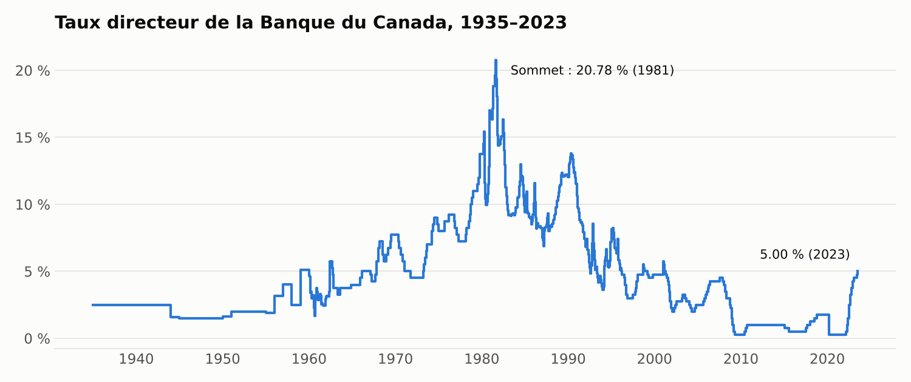
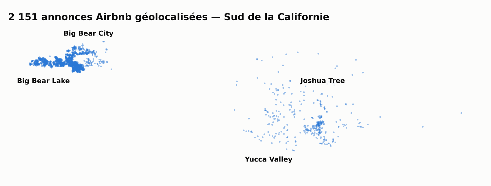

<p align="center">
  
</p>

<p align="center">
  
  
  
  
</p>

<p align="center">
  Tableaux de bord et jeux de données pour explorer Power BI sur des cas concrets :<br>
  <b>finance</b>, <b>immobilier locatif</b>, <b>performance opérationnelle</b> et <b>analyse de contenu</b>.
</p>

---

## 🗂️ Projets

| # | Projet | Domaine | Livrable | Données |
|:-:|---|---|---|---|
| 01 | [📈 Taux directeur de la Banque du Canada](projets/01-taux-directeur-bdc) | Finance | ✅ Tableau de bord `.pbix` | 360 décisions, 1935–2023 |
| 02 | [🏡 Marché Airbnb — Big Bear & Joshua Tree](projets/02-marche-airbnb) | Immobilier | ✅ Tableau de bord `.pbix` | 116 000+ lignes, 2020–2022 |
| 03 | [📞 Performance d'un centre d'appels](projets/03-centre-appels) | Opérations | 🛠️ Données prêtes | 1 251 périodes, 9 KPI |
| 04 | [💬 Discussions politiques sur Reddit](projets/04-reddit-politique) | Données sociales | 🛠️ Données prêtes | 28 000+ publications, 2021 |

---

## 📈 01 — Taux directeur de la Banque du Canada



Premier tableau de bord : évolution historique du taux directeur, avec cartes KPI, jauge, graphique en anneau et filtres par période.
→ [Voir le projet](projets/01-taux-directeur-bdc)

## 🏡 02 — Marché Airbnb dans le sud de la Californie



Exploration du marché de la location courte durée : revenus, taux d'occupation, prix par nuit et carte des annonces (visuel ArcGIS).
→ [Voir le projet](projets/02-marche-airbnb)

## 📞 03 — Centre d'appels &nbsp;·&nbsp; 💬 04 — Reddit

Deux jeux de données prêts pour les prochains tableaux de bord : les KPI d'un centre d'appels (taux de réponse, abandons, niveau de service) et des publications du forum r/politics.

---

## 🎓 Formation

| Ressource | Format |
|---|---|
| [Formation Power BI — Introduction](formation) | Présentation PowerPoint (archive `.zip`) |

---

## 🧭 Organisation du dépôt

```
power-bi/
├── projets/
│   ├── 01-taux-directeur-bdc/   → rapport .pbix + données Excel
│   ├── 02-marche-airbnb/        → rapport .pbix + données CSV (zip)
│   ├── 03-centre-appels/        → données CSV
│   └── 04-reddit-politique/     → données CSV
├── formation/                   → support de formation
└── assets/                      → bannière et aperçus du README
```

## ▶️ Ouvrir un rapport

1. Installer [Power BI Desktop](https://www.microsoft.com/fr-ca/power-platform/products/power-bi/desktop) (gratuit, Windows).
2. Télécharger le fichier `.pbix` du projet.
3. Si Power BI demande les données : **Transformer les données → Paramètres de la source de données**, puis pointer vers le dossier `data/` du projet.

---

<p align="center">
  <sub>Réalisé par <b>Léo Basile</b> · Stratégie d'affaires, IA et analytique · Trois-Rivières, Québec</sub><br><br>
  <a href="https://www.linkedin.com/in/l%C3%A9o-basile-msc-mba-6702025a"></a>
</p>
