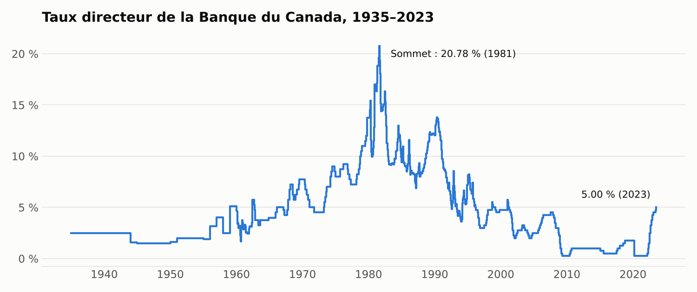

# 📈 Taux directeur de la Banque du Canada

**Question :** comment le taux directeur a-t-il évolué depuis la création de la Banque du Canada ?

| | |
|---|---|
| **Rapport** | [`taux-directeur-bdc.pbix`](taux-directeur-bdc.pbix) — page « Mon premier Dashboard » |
| **Visuels** | Cartes KPI, histogramme, anneau, jauge, segments (filtres) |
| **Données** | [`data/BankofCanadaRateHistory-WOWA.xlsx`](data/BankofCanadaRateHistory-WOWA.xlsx) — 360 décisions de taux, 1935–2023 (source : WOWA) |

### Faits saillants
- Sommet historique : **20,78 %** en août 1981
- Plancher récent : **0,25 %** pendant la pandémie (2020–2022)
- Dernière valeur du jeu de données : **5,00 %** (juillet 2023)

[← Retour au portfolio](../../README.md)
