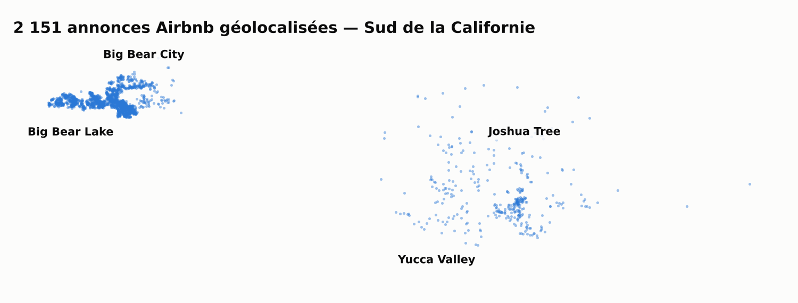

# 🏡 Marché Airbnb — Big Bear & Joshua Tree

**Question :** qu'est-ce qui fait la performance d'une location courte durée dans une région touristique ?

| | |
|---|---|
| **Rapport** | [`exploration-airbnb.pbix`](exploration-airbnb.pbix) |
| **Visuels** | Carte ArcGIS, histogramme, cartes KPI, segments |
| **Données** | [`data/airbnb.zip`](data/airbnb.zip) — 10 fichiers CSV (séparateur `;`, décimale `,`) |

### Contenu des données
| Fichier | Contenu |
|---|---|
| `market_analysis.csv` | 116 619 lignes mensuelles (2020–2022) : revenus, occupation, prix par nuit, durée de séjour |
| `market_analysis_2019.csv` | Même structure, année 2019 |
| `geolocation.csv` | Coordonnées de 2 151 annonces |
| `amenities.csv` | Commodités par annonce |
| `sales_properties_*.csv` | Ventes de propriétés par code postal, avec ou sans piscine |

### Faits saillants
- 4 villes : Big Bear Lake, Big Bear City, Yucca Valley, Joshua Tree
- Taux d'occupation moyen : **44 %** · Prix médian par nuit : **356 $ US**

[← Retour au portfolio](../../README.md)
